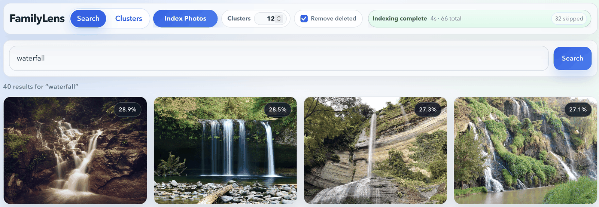
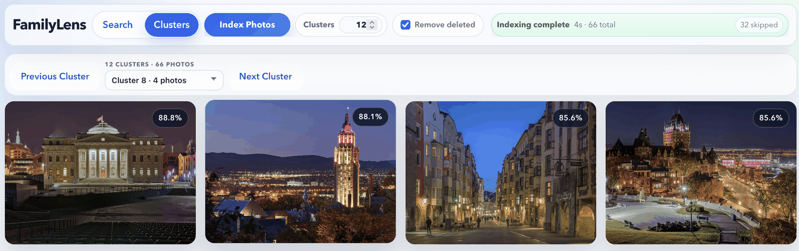
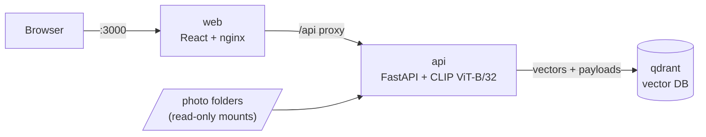

# FamilyLens

[](https://github.com/miwolff/familylens/actions/workflows/ci.yml)
[](LICENSE)



Search your own photo library in plain language, such as "birthday party",
"beach from above" or "grandma at the lake", and browse groups of visually
similar photos (clusters). Everything runs on your machine. Photos, embeddings and
queries never leave it.



## Features

- **Natural-language search** over tens of thousands of photos using CLIP
  image/text embeddings
- **Visual clusters**: photos are grouped into a chosen number of clusters
  after every indexing run, largest first, strongest matches first
- **Incremental indexing** with live progress, ETA, cancellation, and optional
  removal of entries for deleted files
- **RAW support**: Adobe DNG and Nikon NEF next to JPEG and PNG, with
  on-the-fly JPEG previews in the browser
- **Up to five photo folders**, mounted read-only
- **One command to run**: `docker compose up`, with no cloud services and no
  accounts

## Architecture



| Service    | Tech                                      | Role                                                |
| ---------- | ----------------------------------------- | --------------------------------------------------- |
| **web**    | React 19, Vite, nginx                     | Search and cluster UI, reverse proxy to the API      |
| **api**    | FastAPI, sentence-transformers, scikit-learn | Indexing, search, clustering, photo serving       |
| **qdrant** | Qdrant 1.20                               | Stores one 512-dim vector per photo plus metadata    |

**How it works**

1. **Index**: the API walks the photo folders, encodes new images with
   CLIP's image encoder in batches of 32, and upserts the vectors into
   Qdrant. Point IDs are derived from file paths, so re-indexing is
   idempotent and only new files are encoded.
2. **Cluster**: after each run, MiniBatchKMeans groups all vectors. Cluster
   ids are renumbered by size and stored as payload on each point.
3. **Search**: the query is encoded with CLIP's text encoder into the same
   embedding space and matched against image vectors by cosine similarity.
4. **Browse**: the UI shows ranked search results and pages through clusters.

## Design decisions

- **CLIP ViT-B/32 via sentence-transformers.** One model embeds both images
  and text into a shared space, so search needs no captions, tags or labels.
  The B/32 variant runs acceptably on a laptop CPU.
- **Qdrant as a separate vector database.** The vectors could also live in
  the API's memory, but then saving them, looking up photos by cluster and
  counting photos per cluster would all be custom code. Qdrant keeps the index
  on disk across restarts and can filter and count by stored fields. For
  example, the cluster picker asks Qdrant for the number of photos in each
  cluster instead of loading every photo to count them.
- **MiniBatchKMeans for clusters.** It is fast enough to recompute after every
  indexing run at ~30k photos, needs no extra service, and its centroid
  distance gives a natural "how typical is this photo" ordering inside each
  cluster.
- **A background task with in-memory progress.** Indexing runs as a FastAPI
  background task. The UI polls `/api/index/status`, backing off when the
  tab is hidden. This assumes a single API worker, which suits a single-user
  local app and avoids a job queue.
- **Bounded memory.** Images are decoded at reduced size before encoding
  (CLIP works at 224 px), so a batch stays around 100 MB even for 24 MP or
  RAW files. This keeps the stack within an 8 GB laptop.
- **Reproducible builds.** The API image installs exactly what `uv.lock`
  pins, using CPU-only PyTorch wheels on Linux. The CLIP model is downloaded
  at build time and the container runs with `HF_HUB_OFFLINE=1`.

## Quick start

**Prerequisites:** [Docker](https://docs.docker.com/get-docker/) with
Docker Compose.

1. Create your `.env` file and point it at your photos:

   ```bash
   cp .env.example .env
   ```

   ```dotenv
   PHOTOS_DIR=/path/to/your/photos
   # Optional: PHOTOS_DIR_2 … PHOTOS_DIR_5
   ```

   Each folder is mounted read-only at `/photos/1` … `/photos/5` in the API
   container and indexed together.

2. Start the stack:

   ```bash
   docker compose up --build
   ```

3. Open **http://localhost:3000**, click **Index Photos**, and search once
   indexing finishes. Open **Clusters** to browse the visual groups.

## Configuration

Backend settings are environment variables with the `FAMILYLENS_` prefix and
can be set in `.env`:

| Variable                          | Default | Description                                         |
| --------------------------------- | ------- | --------------------------------------------------- |
| `FAMILYLENS_CLUSTER_COUNT`        | `12`    | Default number of clusters built after indexing      |
| `FAMILYLENS_MAX_CLUSTER_COUNT`    | `1000`  | Upper bound accepted for client-supplied counts      |
| `FAMILYLENS_SEARCH_DEFAULT_LIMIT` | `20`    | Default search result limit                          |
| `FAMILYLENS_LOG_LEVEL`            | `INFO`  | Backend log level                                    |

## API

| Method | Endpoint                     | Description                                       |
| ------ | ---------------------------- | ------------------------------------------------- |
| `POST` | `/api/index`                 | Start indexing (body: `folder`, `cleanup`, `cluster_count`, all optional) |
| `GET`  | `/api/index/status`          | Live indexing progress                            |
| `POST` | `/api/index/cancel`          | Cancel the active run                             |
| `POST` | `/api/search`                | Search by text (`query`, optional `limit` ≤ 100)  |
| `GET`  | `/api/clusters`              | List clusters, largest first                      |
| `GET`  | `/api/clusters/{cluster_id}` | One cluster's photos, strongest matches first     |
| `GET`  | `/api/photos/{path}`         | Serve a photo (RAW files as a JPEG preview)       |
| `GET`  | `/api/status`                | Indexed photo count and client limits             |
| `GET`  | `/health`                    | 200 when CLIP and Qdrant are ready, else 503      |

Interactive OpenAPI docs are at http://localhost:8000/docs.

```bash
curl -X POST http://localhost:8000/api/search \
  -H "Content-Type: application/json" \
  -d '{"query": "photos at the beach", "limit": 10}'
```

`folder` in `/api/index` is resolved inside the `/photos` mount tree.
Anything outside it is rejected with 403.

## Development

```
├── docker-compose.yml
├── backend/                  FastAPI service (uv project)
│   ├── app/
│   │   ├── routers/          index, search, clusters endpoints
│   │   └── services/         CLIP, Qdrant and clustering logic
│   ├── scripts/              model download used by the Docker build
│   └── tests/                pytest suite, ML dependencies stubbed
├── frontend/                 React app (Vite), served by nginx
│   └── src/{components,pages,lib}
├── data/photos*/             default (empty) mount points
└── docs/user_requirements.md
```

**Backend** (requires [uv](https://docs.astral.sh/uv/)):

```bash
cd backend
uv sync
uv run pytest            # ~2 s; torch/CLIP are stubbed, no model download
uv run ruff check
uv run ruff format
```

**Frontend:**

```bash
cd frontend
npm ci
npm test
npm run dev              # proxies /api to localhost:8000
```

**CI** runs the backend tests, Ruff lint and format checks, the frontend
tests and the production build on every push to `main` and every pull
request.

**Dependency hygiene.** `uv.lock` and `package-lock.json` pin every
dependency. Both tools are configured to ignore releases younger than seven
days (`exclude-newer` in `pyproject.toml`, `min-release-age` in
`frontend/.npmrc`, npm ≥ 11), which reduces exposure to compromised fresh
releases. Upgrade with `uv lock --upgrade` and `npm update`.

## Security and privacy

- Photo folders are mounted **read-only**. FamilyLens never modifies them.
- The API has **no authentication**. Docker Compose therefore publishes the
  web UI and the API on `127.0.0.1` only, and Qdrant is not published at all.
  If you expose FamilyLens beyond your machine, put it behind a reverse proxy
  with authentication.
- After the image is built, nothing contacts external services: the CLIP
  model is part of the image and runs with Hugging Face offline mode.
- Photo serving and the index `folder` parameter both resolve paths and
  reject anything outside the photo root.

## Limitations and roadmap

- Indexing runs on the CPU. GPU-accelerated indexing is planned.
- Progress state lives in the API process, so the API must run as a single
  worker.
- Search uses visual content only. Combining it with EXIF dates and places
  ("last summer", "in Iceland") is a natural next step.

Tested on a MacBook Air with 8 GB RAM. The stack uses about 2.5 GB while
indexing.

## License

[MIT](LICENSE)
